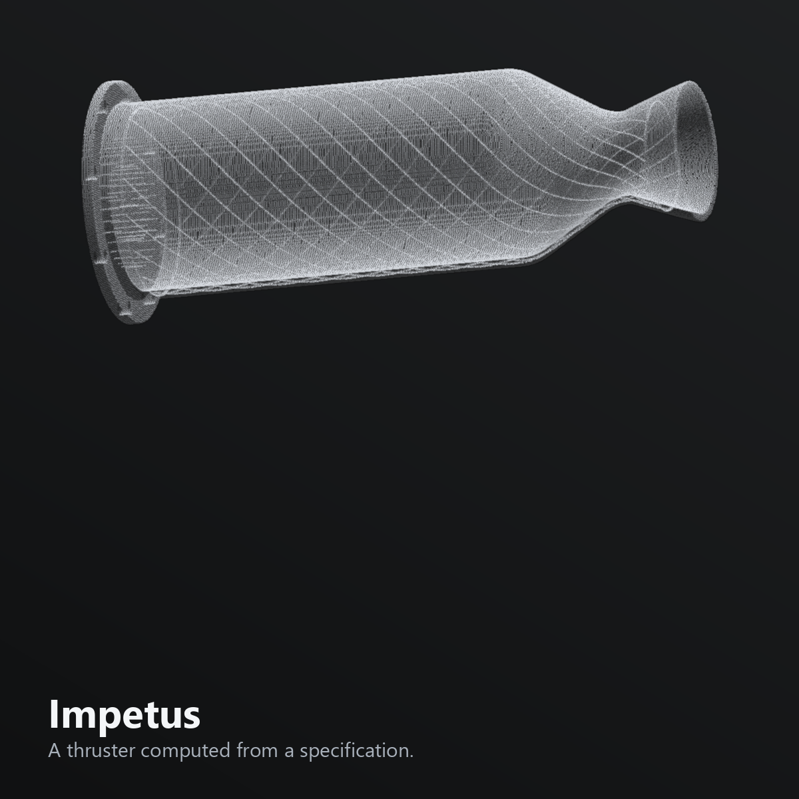
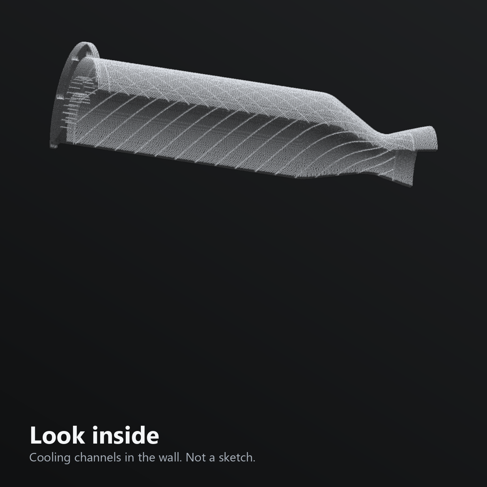
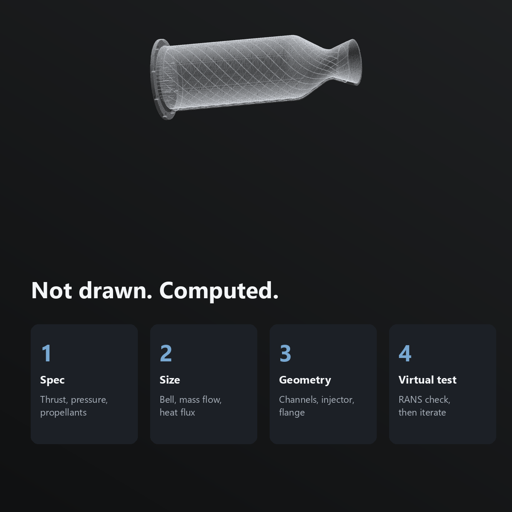

# Impetus

The engine is not drawn. It is **computed** from a specification, checked in a
virtual test, then changed and computed again.

Impetus is a rocket-thruster design tool in the spirit of
[LEAP 71's](https://leap71.com/) computational engineering approach. A small
JSON file sets thrust, chamber pressure, propellants, and mixture ratio. From
that, the program sizes the chamber and Rao bell, builds a regeneratively
cooled geometry, and can run an axisymmetric RANS virtual test. The pictures
below are one result of that loop: a 1 kN-class LOX / kerosene engine
(`designs/PERF-KERO-A`).

<p align="center">
  
</p>

<p align="center">
  
</p>

Built on [PicoGK](https://github.com/leap71/PicoGK) for voxel geometry and
[SU2](https://su2code.github.io/) for CFD.

## The loop

<p align="center">
  
</p>

```
spec.json ──► sizing physics ──► geometry (PicoGK) ──► STL / 3MF
                  │                                        ▲
                  └─► SU2 case ──► virtual test (CFD) ──► report ──► edit spec
```

1. **Specification.** Thrust, chamber pressure, propellants, O/F, expansion.
   One JSON file in `specs/`.
2. **Sizing.** Ideal rocket theory: throat, exit, chamber, mass flow, Isp.
   Gas properties come from CEA-style tables that vary with O/F and chamber
   pressure (`data/gas/`). Wall heat and regen cooling are marched along the
   cooling channels, not guessed as a single temperature rise.
3. **Geometry.** PicoGK builds the cooled chamber and bell, helical channels,
   manifolds, injector, and bolted flange. Output is a watertight STL and a
   3MF with separate `body`, `injector`, and `flange` objects.
4. **Virtual test.** A structured axisymmetric mesh is written for SU2. The
   solver runs RANS-SST with an isothermal wall. Thrust, mass flow, and exit
   Mach are compared with the analytic prediction. Throat heat flux is
   compared with Bartz when SU2 writes it out.
5. **Iterate.** Change the spec and run again. Geometry is seconds to minutes.
   CFD is longer.

This is a screening tool. A report and a mesh are not a hot fire.

## Try it

From the repository root, after the setup below:

```powershell
dotnet run --project src/Impetus -- design specs/demo-1kN.json
```

That writes `designs/IMP-1K-A/`: the report, `engine.stl`, `engine.3mf`, and
the cutaway. Open `report.md` first. Drag `engine_cutaway.stl` into any mesh
viewer to see the channels.

```powershell
dotnet run --project src/Impetus -- validate specs/demo-1kN.json   # analytic gates
dotnet run --project src/Impetus -- view specs/demo-1kN.json       # 3D cutaway window
dotnet run --project src/Impetus -- print specs/demo-1kN.json      # printer bed fit
dotnet run --project src/Impetus -- test specs/demo-1kN.json       # SU2 virtual test
dotnet run --project src/Impetus -- all specs/demo-1kN.json        # design + CFD
```

With no arguments, `all specs/demo-1kN.json` is assumed.

To design another engine, copy a spec, change `name` and the numbers, and run
`design` again. Each name gets its own folder under `designs/`.

| Command | What it does |
|---|---|
| `design` | Size, build geometry, write the report |
| `validate` | Cooling, injector, expansion, and pressure checks |
| `iterate` | Apply corrective spec changes and write a new revision |
| `print` | Envelope and slicer notes, without rebuilding geometry |
| `view` | Open the cutaway in the PicoGK viewer |
| `test` / `all` | Write and run the SU2 case |
| `post` | Re-read an existing CFD result |
| `sweep` / `optimize` / `thrust-sweep` | Explore the spec |
| `manufacturability` | Process-aware geometry checks |
| `diff` | Compare two specs |
| `export-only` | Rebuild meshes from an existing design |
| `stage` / `test-stand` / `post-hotfire` | Stage sizing and hot-fire notes |
| `smoke` | PicoGK sanity check, no engine |

## What you get

| File | Content |
|---|---|
| `report.md` | Performance, geometry, thermal, validation |
| `engine.stl` | Full engine, millimeters, watertight |
| `engine.3mf` | Same geometry, explicit mm units, objects `body`, `injector`, `flange` |
| `engine_cutaway.stl` / `.3mf` | Half-section: channels, manifolds, injector |
| `hotfire-plan.md` | What a physical test still has to prove |
| `cfd/flow.vtu` | Volume field for ParaView, after `test` |
| `cfd/su2.log` | Solver log |

## A specification

`specs/demo-1kN.json` is the starting point:

```json
{
  "name": "IMP-1K-A",
  "thrustN": 1000,
  "chamberPressureBar": 20,
  "ambientPressureBar": 1.01325,
  "propellants": "LOX_Kerosene",
  "ofRatio": 2.3,
  "expansionRatio": 0,
  "bellFraction": 0.8,
  "contractionRatio": 4.0,
  "wallThicknessMM": 3.0,
  "cooling": { "count": 24, "diameterMM": 1.4, "helixTurns": 1.0 },
  "injector": { "type": "CoaxialSwirl", "elementCount": 12 },
  "voxelSizeMM": 0.4
}
```

- `propellants`: `LOX_Kerosene`, `LOX_Methane`, `LOX_Hydrogen`, `N2O_Ethanol`.
  Chamber temperature, γ, and molar mass are interpolated from `data/gas/`
  at the O/F and chamber pressure you set.
- `expansionRatio: 0` sizes the bell so exit pressure matches ambient.
- `injector.type`: `CoaxialSwirl` on the demo. `Showerhead` is still available.
- `voxelSizeMM`: 0.4 mm is a practical default. Smaller is finer and slower.

Every field is in [docs/06-spec-reference.md](docs/06-spec-reference.md).

## Setup (Windows)

**1. .NET SDK 10**

```powershell
winget install Microsoft.DotNet.SDK.10
```

Open a new terminal. `dotnet --version` should print `10.x`.

**2. SU2, only if you want the virtual test**

Download `SU2-vX.Y.Z-win64-omp.zip` from the
[SU2 releases](https://github.com/su2code/SU2/releases). The zip contains a
nested `win64-omp.zip`; extract twice. Impetus looks for `SU2_CFD.exe` under
`tools/`, or you can set `IMPETUS_SU2` to the full path of that executable.
`design` and `validate` work without SU2.

**3. Build and smoke test**

```powershell
dotnet build Impetus.sln
dotnet test tests/Impetus.Tests
dotnet run --project src/Impetus -- smoke
```

`smoke: OK` means the voxel kernel can build a mesh. PicoGK comes from NuGet
on the first build. No separate install.

## 3D printing

FDM output is a **display model**. Plastic does not get hot-fired. The
geometry is intended for metal powder-bed fusion (CuCrZr liner, Inconel bell
and injector).

Import `engine.3mf` (explicit millimeters). Stand the full engine on the
flange, nozzle up, and add a brim. The cutaway prints on its flat cut face.
Start at 0.2 mm layers, 2–3 perimeters, 10–15% infill, PLA or PETG. Cooling
channels and injector orifices are sized for metal AM; a plastic printer will
not hold every bore. `print` writes the bed-fit numbers for the spec you ran.

## Documentation

| | |
|---|---|
| [01 Overview](docs/01-overview.md) | Concept, loop, repository layout |
| [02 Architecture](docs/02-architecture.md) | Code structure and data flow |
| [03 Physics](docs/03-physics.md) | Equations: Sutton, Huzel & Huang, Bartz, Rao |
| [04 Geometry](docs/04-geometry.md) | Voxel geometry in PicoGK |
| [05 CFD](docs/05-cfd.md) | Mesh, SU2 configuration, thrust integration |
| [06 Spec reference](docs/06-spec-reference.md) | Every input, with ranges |
| [07 Workflow](docs/07-workflow.md) | Install, run, iterate, troubleshoot |
| [08 Roadmap](docs/08-roadmap.md) | What is still simplified, and how to deepen it |
| [09 Improvement backlog](docs/09-improvement-backlog.md) | Prioritized work list |
| [10 Gas tables](docs/10-gas-tables.md) | CEA-style Tc, γ, and molar mass grids |

## Limits

- Gas tables cover O/F and chamber pressure. γ stays frozen through the nozzle.
  There is no shifting equilibrium in the expansion.
- CFD is axisymmetric RANS-SST of the hot-gas path. It does not burn
  propellants and it does not solve conjugate cooling.
- The regen model is a 1D march: Bartz on the hot side, conduction through the
  liner, Gnielinski on the coolant side, plus channel pressure drop.
- A passing virtual check is not permission to fire an engine.

## Credits

- [PicoGK](https://github.com/leap71/PicoGK) (Apache-2.0) by LEAP 71
- [SU2](https://su2code.github.io/) (LGPL-2.1) by the SU2 Foundation
- Methods: Sutton & Biblarz, *Rocket Propulsion Elements*; Huzel & Huang,
  *Modern Engineering for Design of Liquid-Propellant Rocket Engines*;
  Bartz (1957); Rao (1958)
